[← README](../README.md)

## Dependency graph

Generated from the sources, not drawn by hand; the colouring is cross-checked
against `#print axioms` and agrees. Amber would mark a declaration imported as an
axiom and blue one resting on such an import; there are none left, so every node
is green, proved outright. The graph covers the original development only, not
the mirrored Prove2Me results under `Diaz/Mirror/`. Helper lemmas are omitted here for legibility; `dependency-graph.dot`
carries all 61, grouped by file. Both are transitively reduced: an edge
implied by a longer path is not drawn, so a declaration's full
dependency set is its ancestors, not just its parents.

Regenerate with `scripts/depgraph.py` after any change to the Lean;
nothing here is hand-maintained.

```mermaid
flowchart TD
  subgraph Axioms["Axioms.lean"]
    hermite_lindemann("hermite_lindemann")
    exists_ringHom_of_transcendental("exists_ringHom_of_transcendental")
  end
  subgraph Closure["Closure.lean"]
    hull("hull")
    transcendental_ne_zero("transcendental_ne_zero")
    ne_zero_of_notMem("ne_zero_of_notMem")
    conj_eq_rho_div("conj_eq_rho_div")
    conj_mem_hull("conj_mem_hull")
    conj_not_linear("conj_not_linear")
    conj_not_linear_hull("conj_not_linear_hull")
    eqOn_hull("eqOn_hull")
    transcendental_of_candidate("transcendental_of_candidate")
    transcendental_of_base("transcendental_of_base")
    transcendental_candidate_over_base("transcendental_candidate_over_base")
  end
  subgraph Model["Model.lean"]
    norm_form("norm_form")
    sq_add_sq_notMem("sq_add_sq_notMem")
    norm_mem_iff("norm_mem_iff")
    indep("indep")
    conj_coords("conj_coords")
    transcendental_exp_I("transcendental_exp_I")
    exists_transcendental_on_circle("exists_transcendental_on_circle")
    exists_transcendental_on_circle_sq("exists_transcendental_on_circle_sq")
  end
  subgraph Exponential["Exponential.lean"]
    isAlgebraic_two_rpow("isAlgebraic_two_rpow")
    Exp0("Exp0")
    Exp0_add("Exp0_add")
    Exp0_swap_conj("Exp0_swap_conj")
    Exp0_isAlgebraic("Exp0_isAlgebraic")
    Exp0_eq_one_iff("Exp0_eq_one_iff")
    Exp0_pow_eq_one_iff("Exp0_pow_eq_one_iff")
    model_falsifies("model_falsifies")
  end
  subgraph Transfer["Transfer.lean"]
    conj_comm("conj_comm")
    coeff_transfer("coeff_transfer")
    Hmat_transfer("Hmat_transfer")
    exists_conj_intertwining("exists_conj_intertwining")
  end
  subgraph Rigidity["Rigidity.lean"]
    Hmat("Hmat")
    det_Hmat("det_Hmat")
    no_vanishing_coeff("no_vanishing_coeff")
    coeff_eq_matrix("coeff_eq_matrix")
    no_vanishing_coeff_matrix("no_vanishing_coeff_matrix")
    candidate_no_vanishing_coeff("candidate_no_vanishing_coeff")
  end
  subgraph Instantiation["Instantiation.lean"]
    Qbar("Qbar")
    QbarIsAlgebraic("QbarIsAlgebraic")
    mem_Qbar_iff("mem_Qbar_iff")
    conj_mem_Qbar("conj_mem_Qbar")
    candidate_no_vanishing_coeff_Qbar("candidate_no_vanishing_coeff_Qbar")
    exists_transcendental_on_circle_Qbar("exists_transcendental_on_circle_Qbar")
    candidate_indistinguishable("candidate_indistinguishable")
  end
  subgraph Nodes["Nodes.lean"]
    not_on_axes("not_on_axes")
    plane_norm("plane_norm")
    indep_three("indep_three")
    four_nodes("four_nodes")
    sq_notMem_of_transcendental("sq_notMem_of_transcendental")
    four_nodes_candidate("four_nodes_candidate")
  end
  conj_eq_rho_div --> conj_mem_hull
  hull --> conj_not_linear_hull
  hull --> eqOn_hull
  hermite_lindemann --> transcendental_of_candidate
  transcendental_of_base --> transcendental_candidate_over_base
  transcendental_of_candidate --> transcendental_candidate_over_base
  norm_form --> norm_mem_iff
  sq_add_sq_notMem --> norm_mem_iff
  conj_eq_rho_div --> indep
  sq_add_sq_notMem --> indep
  transcendental_ne_zero --> indep
  transcendental_of_candidate --> transcendental_exp_I
  transcendental_exp_I --> exists_transcendental_on_circle
  transcendental_of_base --> exists_transcendental_on_circle
  exists_transcendental_on_circle --> exists_transcendental_on_circle_sq
  Exp0 --> Exp0_add
  Exp0 --> Exp0_isAlgebraic
  isAlgebraic_two_rpow --> Exp0_isAlgebraic
  Exp0 --> Exp0_eq_one_iff
  Exp0_eq_one_iff --> Exp0_pow_eq_one_iff
  Exp0_isAlgebraic --> model_falsifies
  conj_eq_rho_div --> conj_comm
  eqOn_hull --> conj_comm
  Hmat --> Hmat_transfer
  conj_comm --> Hmat_transfer
  conj_comm --> exists_conj_intertwining
  exists_ringHom_of_transcendental --> exists_conj_intertwining
  transcendental_ne_zero --> exists_conj_intertwining
  Hmat --> det_Hmat
  ne_zero_of_notMem --> no_vanishing_coeff
  Hmat --> coeff_eq_matrix
  coeff_eq_matrix --> no_vanishing_coeff_matrix
  no_vanishing_coeff --> no_vanishing_coeff_matrix
  no_vanishing_coeff_matrix --> candidate_no_vanishing_coeff
  transcendental_candidate_over_base --> candidate_no_vanishing_coeff
  Qbar --> QbarIsAlgebraic
  Qbar --> mem_Qbar_iff
  mem_Qbar_iff --> conj_mem_Qbar
  Qbar --> candidate_no_vanishing_coeff_Qbar
  candidate_no_vanishing_coeff --> candidate_no_vanishing_coeff_Qbar
  conj_mem_Qbar --> exists_transcendental_on_circle_Qbar
  exists_transcendental_on_circle --> exists_transcendental_on_circle_Qbar
  conj_mem_Qbar --> candidate_indistinguishable
  exists_conj_intertwining --> candidate_indistinguishable
  exists_transcendental_on_circle_sq --> candidate_indistinguishable
  transcendental_candidate_over_base --> candidate_indistinguishable
  conj_eq_rho_div --> indep_three
  transcendental_ne_zero --> indep_three
  plane_norm --> four_nodes
  four_nodes --> four_nodes_candidate
  not_on_axes --> four_nodes_candidate
  sq_notMem_of_transcendental --> four_nodes_candidate
  transcendental_candidate_over_base --> four_nodes_candidate
  classDef ax fill:#f5c26b,stroke:#b8860b,color:#000
  classDef onax fill:#bcd9f5,stroke:#3a6ea5,color:#000
  classDef proved fill:#c6e9c6,stroke:#3c8a3c,color:#000
  class hermite_lindemann,exists_ringHom_of_transcendental,hull,transcendental_ne_zero,ne_zero_of_notMem,conj_eq_rho_div,conj_mem_hull,conj_not_linear,conj_not_linear_hull,eqOn_hull,transcendental_of_candidate,transcendental_of_base,transcendental_candidate_over_base,norm_form,sq_add_sq_notMem,norm_mem_iff,indep,conj_coords,transcendental_exp_I,exists_transcendental_on_circle,exists_transcendental_on_circle_sq,isAlgebraic_two_rpow,Exp0,Exp0_add,Exp0_swap_conj,Exp0_isAlgebraic,Exp0_eq_one_iff,Exp0_pow_eq_one_iff,model_falsifies,conj_comm,coeff_transfer,Hmat_transfer,exists_conj_intertwining,Hmat,det_Hmat,no_vanishing_coeff,coeff_eq_matrix,no_vanishing_coeff_matrix,candidate_no_vanishing_coeff,Qbar,QbarIsAlgebraic,mem_Qbar_iff,conj_mem_Qbar,candidate_no_vanishing_coeff_Qbar,exists_transcendental_on_circle_Qbar,candidate_indistinguishable,not_on_axes,plane_norm,indep_three,four_nodes,sq_notMem_of_transcendental,four_nodes_candidate proved
```

The shape of it was the point, and it has changed. Everything is green. Two thin
chains used to be blue — transcendence of a candidate, and the existence of the
isomorphism — each ending at an amber node, Hermite–Lindemann and the Steinitz
extension. Both of those are now proved in `Axioms.lean`, so the chains rest on
nothing but Lean's own axioms.

